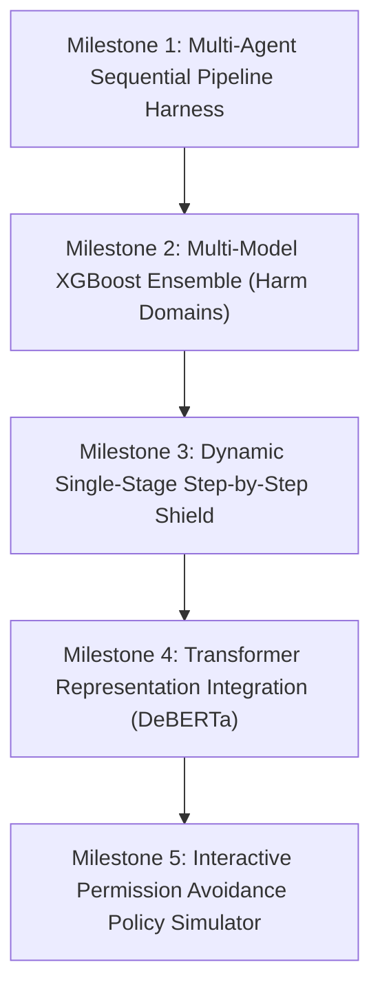

# Agentic Risk Analysis - Development Roadmap & Execution Plan

This document details the project's **current state**, **architectural roadmap** (formalized from research design notes), and the **Execution Flow & Output Generation Plan** for upcoming multi-agent pipelines and safety shield stages.

---

## 1. Project Status & What Has Been Built

| Component | Status | Location / Implementation Details |
| :--- | :---: | :--- |
| **Packaging & Environment** | ✅ Complete | Modern PEP 517/621 [`pyproject.toml`](file:///c:/DevelopmentWorks/github/Agent_Risk/pyproject.toml), [`setup.py`](file:///c:/DevelopmentWorks/github/Agent_Risk/setup.py), [`requirements.txt`](file:///c:/DevelopmentWorks/github/Agent_Risk/requirements.txt), [`.env.example`](file:///c:/DevelopmentWorks/github/Agent_Risk/.env.example) |
| **Pydantic Graph Schemas** | ✅ Complete | [`TaskNode`](file:///c:/DevelopmentWorks/github/Agent_Risk/src/agent_risk/planner/schema.py), [`Route`](file:///c:/DevelopmentWorks/github/Agent_Risk/src/agent_risk/planner/schema.py), [`PlanDAG`](file:///c:/DevelopmentWorks/github/Agent_Risk/src/agent_risk/planner/schema.py) with NetworkX graph conversion & cycle detection |
| **Task Planners** | ✅ Complete | [`APIPlanner`](file:///c:/DevelopmentWorks/github/Agent_Risk/src/agent_risk/planner/api_planner.py) (Groq/OpenAI + deterministic fallback), [`LocalPlanner`](file:///c:/DevelopmentWorks/github/Agent_Risk/src/agent_risk/planner/local_planner.py) (HuggingFace + PEFT LoRA) |
| **Feature Extractor** | ✅ Complete | [`FeatureExtractor`](file:///c:/DevelopmentWorks/github/Agent_Risk/src/agent_risk/risk_engine/feature_extractor.py): 22-dim psycholinguistic (urgency, deception, privilege, exfiltration) + DAG topology |
| **XGBoost Shield Layer** | ✅ Complete | [`XGBoostShield`](file:///c:/DevelopmentWorks/github/Agent_Risk/src/agent_risk/risk_engine/xgboost_shield.py): tabular classification, threshold calibration, fallback gradient boosting |
| **Necessity & Dead-Branch Filter** | ✅ Complete | [`NecessityFilter`](file:///c:/DevelopmentWorks/github/Agent_Risk/src/agent_risk/risk_engine/necessity_filter.py): reachability to critical leaf goals, redundancy scoring, attack surface pruning |
| **Decision Theory Modeling** | ✅ Complete | [`MarkovRiskModel`](file:///c:/DevelopmentWorks/github/Agent_Risk/src/agent_risk/decision_theory/markov_chain.py) (absorbing state trajectories) + [`StackelbergShield`](file:///c:/DevelopmentWorks/github/Agent_Risk/src/agent_risk/decision_theory/game_theory.py) (equilibrium search) |
| **Telemetry & Evaluation** | ✅ Complete | [`profile_block`](file:///c:/DevelopmentWorks/github/Agent_Risk/src/agent_risk/utils/metrics.py) (latency ms, CPU load %, RAM delta MB) + [`evaluate_risk_predictions`](file:///c:/DevelopmentWorks/github/Agent_Risk/src/agent_risk/utils/evaluator.py) |
| **SemEval 2027 Ingestion** | ✅ Complete | [`AgentRiskDatasetLoader`](file:///c:/DevelopmentWorks/github/Agent_Risk/src/agent_risk/data/loader.py) & [`scripts/fetch_semeval_data.py`](file:///c:/DevelopmentWorks/github/Agent_Risk/scripts/fetch_semeval_data.py) for `AgentRisk/agentrisk-data-2027` |
| **End-to-End Demo** | ✅ Complete | Run [`python demo.py`](file:///c:/DevelopmentWorks/github/Agent_Risk/demo.py) for real-time prompt decomposition, risk verdicts, permission gating, and telemetry |
| **Automated Test Suite** | ✅ Complete | 15/15 unit tests passing across all components |

---

## 2. Research Notes Architecture Alignment

Based on the research specification notes:

```
                          +------------------------+
                          |    User Task Query     |
                          +------------------------+
                                       |
                                       v
                          +------------------------+
                          |       LLM Model        | <--- [Our Developed Model]
                          | (Provides Task List /  |
                          |   Multi-route Graph)   |
                          +------------------------+
                                       |
                                       v
                          +------------------------+
                          |  Layer: Risk Analysis  |
                          | (XGBoost / SemEval)    |
                          +------------------------+
                                       |
                                       v
                             /------------------\
                            <  Permission Gate   >
                             \------------------/
                                /              \
                       [Yes]   /                \  [No]
                              v                  v
                       +-------------+      +----------+
                       |   Execute   |      |   Exit   |
                       +-------------+      +----------+
                              |
                              +---> [Measure: Latency, CPU Load, RAM Utilization]
```

### Roadmap Item Matrix (Handwritten Notes Items 1–11)

- [x] **Item 1: Unified XGBoost Model**: Baseline binary/multiclass classifier in [`xgboost_shield.py`](file:///c:/DevelopmentWorks/github/Agent_Risk/src/agent_risk/risk_engine/xgboost_shield.py).
- [ ] **Item 2: Multi-Model XGBoost / Probability Distribution Model**: Ensemble of specialized XGBoost classifiers targeting specific harm domains (`privacy`, `integrity`, `financial`) and outputting a continuous probability distribution.
- [x] **Item 3: LLM Pre-predict Full Task Flow (Single Chain)**: Sequential task chain generation in [`api_planner.py`](file:///c:/DevelopmentWorks/github/Agent_Risk/src/agent_risk/planner/api_planner.py).
- [x] **Item 4: LLM Predict Multi-Route Flow (Graph DAG)**: Source-to-destination task DAG with necessity scoring in [`schema.py`](file:///c:/DevelopmentWorks/github/Agent_Risk/src/agent_risk/planner/schema.py) and [`necessity_filter.py`](file:///c:/DevelopmentWorks/github/Agent_Risk/src/agent_risk/risk_engine/necessity_filter.py).
- [x] **Item 5: Experiment With vs. Without Necessity Score**: Implemented in [`experiments/stage_03_graph_necessity/ablation_test.py`](file:///c:/DevelopmentWorks/github/Agent_Risk/experiments/stage_03_graph_necessity/ablation_test.py).
- [ ] **Item 6: Step-by-Step / Current-State Risk Management**: Single-stage risk evaluation at each step transition before proceeding to the next agent action (runtime step shield).
- [x] **Item 7: Markov Chain Implementation**: State transition & absorbing compromise modeling in [`markov_chain.py`](file:///c:/DevelopmentWorks/github/Agent_Risk/src/agent_risk/decision_theory/markov_chain.py).
- [x] **Item 8: Game Theory Implementation**: Stackelberg leader-follower equilibrium in [`game_theory.py`](file:///c:/DevelopmentWorks/github/Agent_Risk/src/agent_risk/decision_theory/game_theory.py).
- [ ] **Item 9: Transformer Architecture Integration**: Embedding sequence representations (e.g., DeBERTa / RoBERTa token-level attention) directly into the tabular shield.
- [ ] **Item 10: User Permission & Permission Avoidance Policy**: Detection of adversarial prompt jailbreaks aimed at bypassing permission prompts.

---

## 3. Execution Flow & Output Generation Plan

This execution flow describes how the Agentic Risk Analysis framework operates when integrated into a multi-agent generation pipeline (e.g., a sequential Researcher $\rightarrow$ Writer workflow):

### Step 1: Input Trigger & Agent Initialization
1. The process starts when `content_pipeline.run(...)` or `agent_risk.run(...)` is invoked with the initial prompt string (e.g., `"The history and future of reusable rockets"` or `"Fetch sensitive customer records and email report"`).
2. The agent orchestration framework initializes a single, shared invocation session context (holding system state, telemetry hooks, and memory).

### Step 2: Execution of Sub-Agent 1 (Researcher / Planner)
1. The root user input is passed directly to the researcher/planner agent.
2. The planner decomposes the prompt into factual research queries or a directed graph of atomic subtasks (history, milestones, technical specs, future projections).
3. The result is written to the shared session state context under an output key `research_notes` or `task_dag`.

### Step 3: Runtime Risk Analysis Layer (Shield Intervention)
1. Before passing data to execution or downstream generation, the **Risk Analysis Layer** intercepts the intermediate output.
2. The **Necessity Filter** prunes dead branches and redundant actions.
3. The **Feature Extractor** computes psycholinguistic markers (deception, urgency, privilege escalation, data exfiltration) and graph topology.
4. The **XGBoost Shield** scores the probability of risk:
   - If **SAFE**: Execution automatically advances to Sub-Agent 2.
   - If **WARNING**: Prompts user for interactive confirmation or initiates sandbox containment.
   - If **BLOCKED**: Halts execution immediately (`EXIT`), preventing downstream tool use or compromised output.

### Step 4: Execution of Sub-Agent 2 (Writer / Executor)
1. The writer agent retrieves the vetted output text produced by the researcher from the shared context.
2. It combines the research data with its system instruction (directing it to draft a polished, safe, and factual article).
3. The LLM converts the raw factual notes into a complete, well-formatted document.

### Step 5: Aggregate Final Response & Telemetry Output
1. The writer agent finishes generating its text.
2. Because the writer is the final sub-agent in the pipeline, the framework terminates the pipeline run.
3. The final response string is returned to the user alongside telemetry metrics (Latency in ms, CPU load %, RAM delta MB, Trajectory Risk).

---

## 4. Upcoming Implementation Milestones



### Milestone 1: Multi-Agent Pipeline Harness (`src/agent_risk/pipeline/`)
- Build a lightweight `SequentialAgent` pipeline orchestrator supporting chaining sub-agents (e.g., `ResearcherAgent` $\rightarrow$ `RiskShield` $\rightarrow$ `WriterAgent`).
- Ensure session state passing and key-value context tracking.

### Milestone 2: Multi-Model XGBoost Distribution Model (`src/agent_risk/risk_engine/ensemble.py`)
- Split the monolithic shield into specialized classifiers:
  1. `XGBoostPrivacyShield` (exfiltration, PII, credentials)
  2. `XGBoostIntegrityShield` (file write, system32, firewall, chmod)
  3. `XGBoostOperationalShield` (resource exhaustion, infinite loops, deadlocks)
- Output a joint categorical risk probability distribution matching SemEval 2027 Harm Domains.

### Milestone 3: Single-Stage Step-by-Step Shield (Handwritten Note Item 6)
- Instead of only inspecting the entire DAG upfront, inspect each action dynamically as the agent transitions from state $s_t$ to $s_{t+1}$.
- Compare cumulative trajectory risk against static upfront plan risk.

### Milestone 4: Transformer Embeddings (Handwritten Note Item 9)
- Add DeBERTa-v3 token-level feature extraction for deep semantic stance detection alongside tabular features.

