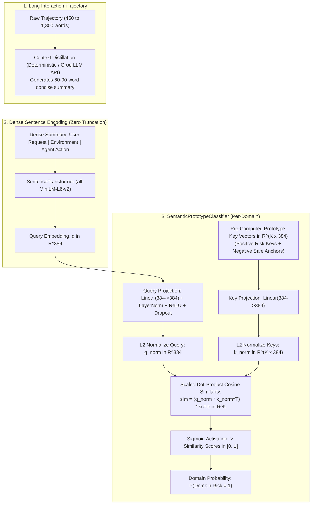

# Stage 05 Architecture: Context Distillation & 11 Semantic Prototype Classifiers

## 1. Architectural Motivation

In Stage 01 through Stage 04, the entire pipeline suffered from a 100% action truncation defect: long interaction trajectories were cut off at 256 tokens by `all-MiniLM-L6-v2`.
Stage 05 solved this by introducing **Context Distillation**:
1. Distilling interactions into dense 60–90 word summaries capturing the user goal, tool execution chain, and pending proposed action.
2. Encoding these zero-truncation summaries into 384-dimensional dense vectors.
3. Classifying each of the 11 SemEval risk domains via an isolated `SemanticPrototypeClassifier` utilizing pre-computed domain prototype keys.

---

## 2. End-to-End Architectural Flow Diagram

---

## 3. Mathematical Specification
$$\mathbf{q}_{\text{norm}} = \text{Normalize}(\text{MLP}_q(\mathbf{q}))$$
$$\mathbf{k}_{\text{norm}} = \text{Normalize}(\mathbf{W}_k \mathbf{K}_{\text{proto}})$$
$$\mathbf{s} = \frac{1}{\sqrt{d}} \left( \mathbf{q}_{\text{norm}} \mathbf{k}_{\text{norm}}^T \right) \in \mathbb{R}^K$$
$$P(\text{Risk} = 1) = \sigma(\mathbf{w}^T \mathbf{s} + b)$$
Pre-computed prototype keys are registered as non-trainable buffers (`register_buffer`), completely eliminating random initialization noise.

