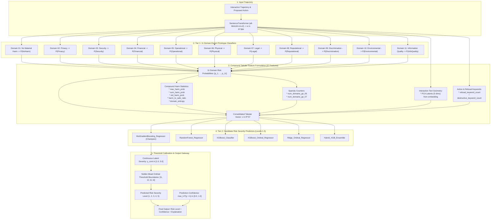

# Stage 06 Architecture: Multi-Domain Probability Ensemble & Severity Predictor

## 1. Architectural Motivation

Predicting the ordinal **Risk Severity (Levels 1 to 5)** directly from raw text fails because text-level regressors lack grounding in specific domain hazards.
Stage 06 addresses this by constructing a **Two-Tier Hierarchical Framework**:
1. **Tier 1 (Domain Expert Feature Extractor)**: Interaction embeddings are evaluated against all 11 Domain Prototype Classifiers, extracting 11 calibrated domain risk probabilities plus 26 engineered statistical & context features (37 tabular features total).
2. **Tier 2 (Ordinal Risk Predictor)**: Tree-based ensembles (XGBoost, HistGradientBoosting, Random Forest) and continuous ordinal regressors map the 37-dimensional feature representation into discrete severity levels 1–5 with calibrated confidence.

---

## 2. End-to-End Architectural Flow Diagram

---

## 3. Mathematical Specification
1. **Domain Feature Vector**:
   $\mathbf{p} = [p_{\text{noharm}}, p_{\text{privacy}}, \dots, p_{\text{info}}] \in [0, 1]^{11}$
2. **Compound Statistics**:
   - `max_harm_prob`: $\max_{k \ge 2} p_k$
   - `std_harm_prob`: $\text{Std}(p_2, \dots, p_{11})$
   - `harm_to_safe_ratio`: $\frac{\sum_{k \ge 2} p_k}{p_{\text{noharm}} + 10^{-4}}$
   - `domain_entropy`: $-\sum_{k=1}^{11} \tilde{p}_k \log(\tilde{p}_k + 10^{-6})$
3. **Continuous-to-Ordinal Discretization**:
   $$\hat{Y} = 1 + \sum_{j=1}^4 \mathbb{I}(y_{\text{cont}} \ge \theta_j)$$
   Where boundaries $\boldsymbol{\theta} = [\theta_1, \theta_2, \theta_3, \theta_4]$ are optimized via Nelder-Mead simplex to maximize Quadratic Weighted Kappa (QWK).

