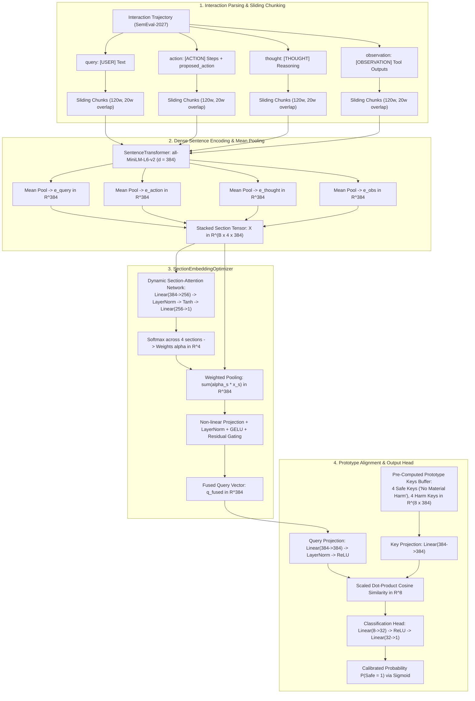

# Stage 07 Architecture: Multi-Section Chunked Embedding Optimizer

## 1. Architectural Overview & Design Rationale

Stage 07 was designed to investigate whether disentangling the interaction trajectory into 4 structural sections (`[USER]`, `[ACTION]`, `[THOUGHT]`, and `[OBSERVATION]`) combined with sliding-window chunking could overcome the 256-token cutoff defect of standard dense sentence encoders.

---

## 2. End-to-End Architectural Flow Diagram

---

## 3. Mathematical Formulation
* **Section Representations**: For section $s \in \{\text{query}, \text{action}, \text{thought}, \text{obs}\}$, sliding chunks $C_{s,1}, \dots, C_{s,M}$ are encoded and mean-pooled:
  $$\mathbf{x}_s = \text{Normalize}\left(\frac{1}{M}\sum_{m=1}^M \text{Encoder}(C_{s,m})\right) \in \mathbb{R}^{384}$$
* **Dynamic Section Attention**:
  $$\alpha_s = \frac{\exp(\mathbf{w}_a^T \tanh(\mathbf{W}_1 \mathbf{x}_s + \mathbf{b}_1))}{\sum_{k=1}^4 \exp(\mathbf{w}_a^T \tanh(\mathbf{W}_1 \mathbf{x}_k + \mathbf{b}_1))}$$
* **Prototype Dot-Product Similarity**:
  $$\mathbf{s}[j] = \frac{1}{\sqrt{d}} \left(\frac{\mathbf{W}_q \mathbf{q}_{\text{fused}}}{\|\mathbf{W}_q \mathbf{q}_{\text{fused}}\|} \cdot \frac{\mathbf{W}_k \mathbf{k}_j}{\|\mathbf{W}_k \mathbf{k}_j\|}\right)$$

