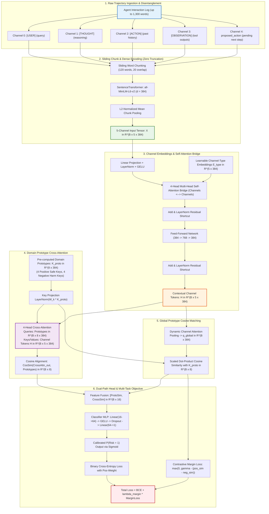

# Stage 08 Architecture: 5-Channel Cross-Attentive Prototype Network

## 1. Research Motivation & Problem Formulation

In Autonomous LLM Agent safety research (such as SemEval-2027 AgentRisk), evaluating potential harm requires inspecting complete interaction trajectories. Standard dense text encoders (e.g., `all-MiniLM-L6-v2`) impose a hard token budget of 256 tokens. Because real agent trajectories frequently span 450 to 1,300 words with dense environment feedback, standard truncation drops up to 80% of downstream tool outputs and action arguments—the exact location where material harm occurs.

Furthermore, empirical analysis in Stage 07 revealed the **Semantic Dilution Problem**: when past historical actions (`context_actions`) and the pending execution command (`proposed_action`) are merged into a single vector representation, benign past diagnostic commands (e.g., `ls`, `grep`, `status`) dilute and obscure a malicious pending command (e.g., `rm -rf` or credential exfiltration).

Stage 08 addresses these foundational challenges through:
1. **5-Channel Semantic Disentanglement**: Isolating user intent, internal reasoning, past actions, environment feedback, and pending executions.
2. **Sliding Word Chunking with Invariant Mean Pooling**: Eliminating token truncation across all interaction lengths.
3. **Self-Attention Context Bridge**: Establishing bidirectional cross-talk between tool observations and pending proposed actions.
4. **Domain-Prototype Cross-Attention**: Safety prototype keys act as active query probes querying the 5 interaction channels.
5. **Contrastive Prototype Margin Loss**: Forcing a geometric separation between benign and hazardous interaction manifolds.

---

## 2. End-to-End Architectural Flow Diagram

---

## 3. Layer-by-Layer Mathematical Specification

### 3.1 5-Channel Disentanglement & Vectorization
For sample $i$, the text is mapped into 5 semantic channels:
$$\mathcal{C}_i = \left\{ \mathbf{t}_{\text{query}}, \, \mathbf{t}_{\text{thought}}, \, \mathbf{t}_{\text{context\_actions}}, \, \mathbf{t}_{\text{observations}}, \, \mathbf{t}_{\text{proposed\_action}} \right\}$$

Each text $\mathbf{t}_c$ is tokenized into word chunks $C_{c,1}, \dots, C_{c,M_c}$ of maximum 120 words with 20-word stride. Each chunk is encoded via SentenceTransformer `all-MiniLM-L6-v2`:
$$\mathbf{e}_{c,m} = \text{Encoder}(C_{c,m}) \in \mathbb{R}^{384}$$
The channel representation is formed via $L_2$-normalized mean pooling:
$$\mathbf{x}_{i,c} = \frac{\frac{1}{M_c} \sum_{m=1}^{M_c} \mathbf{e}_{c,m}}{\left\| \frac{1}{M_c} \sum_{m=1}^{M_c} \mathbf{e}_{c,m} \right\|_2} \in \mathbb{R}^{384}$$
Yielding stacked tensor $\mathbf{X}_i \in \mathbb{R}^{5 \times 384}$.

### 3.2 Channel-Type Embeddings & Self-Attention Bridge
To inject channel semantics (e.g. distinguishing an action from an observation), learnable positional role embeddings $\mathbf{E}_{\text{type}} \in \mathbb{R}^{5 \times d}$ ($d=384$) are added:
$$\mathbf{H}_i^{(0)} = \text{LayerNorm}(\mathbf{W}_{\text{in}} \mathbf{X}_i + \mathbf{b}_{\text{in}}) + \mathbf{E}_{\text{type}}$$

The tokens interact via Multi-Head Self-Attention (4 heads):
$$\mathbf{H}_i^{(1)} = \text{LayerNorm}\left(\mathbf{H}_i^{(0)} + \text{MHA}(\mathbf{H}_i^{(0)}, \mathbf{H}_i^{(0)}, \mathbf{H}_i^{(0)})\right)$$
$$\mathbf{H}_i = \text{LayerNorm}\left(\mathbf{H}_i^{(1)} + \text{FFN}(\mathbf{H}_i^{(1)})\right) \in \mathbb{R}^{5 \times d}$$
*Key Insight*: This allows `proposed_action` to attend directly to sensitive artifacts exposed in `observations`.

### 3.3 Domain-Prototype Cross-Attention
Let $\mathbf{K}_{\text{proto}} \in \mathbb{R}^{K \times 384}$ ($K=8$) represent pre-computed semantic prototype keys (4 Positive Safe anchors + 4 Negative Harm anchors).
Prototypes are projected:
$$\mathbf{Q}_{\text{proto}} = \text{LayerNorm}(\mathbf{W}_k \mathbf{K}_{\text{proto}}) \in \mathbb{R}^{K \times d}$$
The prototypes act as queries, searching over the 5 contextual channel tokens $\mathbf{H}_i$:
$$\mathbf{Z}_{\text{cross}} = \text{MHA}\left(\mathbf{Q}_{\text{proto}}, \, \mathbf{H}_i, \, \mathbf{H}_i\right) \in \mathbb{R}^{K \times d}$$
$$\mathbf{Z}_{\text{cross}} = \text{LayerNorm}(\mathbf{Q}_{\text{proto}} + \mathbf{Z}_{\text{cross}})$$
The cross-attended affinity vector is calculated via cosine similarity:
$$\mathbf{s}_{\text{cross}}[k] = \frac{\mathbf{Z}_{\text{cross}}[k] \cdot \mathbf{Q}_{\text{proto}}[k]}{\|\mathbf{Z}_{\text{cross}}[k]\|_2 \|\mathbf{Q}_{\text{proto}}[k]\|_2} \in \mathbb{R}^K$$

### 3.4 Global Prototype Similarity
A global query vector is computed via attention pooling:
$$\alpha_c = \frac{\exp(\mathbf{w}_{\text{pool}}^T \tanh(\mathbf{W}_p \mathbf{H}_{i,c}))}{\sum_{j=1}^5 \exp(\mathbf{w}_{\text{pool}}^T \tanh(\mathbf{W}_p \mathbf{H}_{i,j}))}$$
$$\mathbf{q}_{\text{global}} = \sum_{c=1}^5 \alpha_c \mathbf{H}_{i,c} \in \mathbb{R}^d$$
$$\mathbf{s}_{\text{proto}} = \frac{1}{\sqrt{d}} \left( \frac{\mathbf{q}_{\text{global}}}{\|\mathbf{q}_{\text{global}}\|_2} \cdot \frac{\mathbf{Q}_{\text{proto}}^T}{\|\mathbf{Q}_{\text{proto}}\|_2} \right) \in \mathbb{R}^K$$

### 3.5 Dual-Path Classification Head & Combined Margin Loss
The features are concatenated:
$$\mathbf{f}_i = [\mathbf{s}_{\text{proto}}, \, \mathbf{s}_{\text{cross}}] \in \mathbb{R}^{2K} \quad (16\text{-dimensional})$$
Logit $\hat{z}_i = \mathbf{W}_2 \text{GELU}(\text{LayerNorm}(\mathbf{W}_1 \mathbf{f}_i))$ and probability $\hat{y}_i = \sigma(\hat{z}_i)$.

**Loss Function**:
$$\mathcal{L} = \mathcal{L}_{\text{BCE}}(\hat{z}_i, y_i) + \lambda_{\text{margin}} \mathcal{L}_{\text{margin}}$$
$$\mathcal{L}_{\text{margin}} = y_i \cdot \max\left(0, \gamma - (\bar{s}_{\text{pos}} - \bar{s}_{\text{neg}})\right) + (1 - y_i) \cdot \max\left(0, \gamma - (\bar{s}_{\text{neg}} - \bar{s}_{\text{pos}})\right)$$
Where separation margin $\gamma = 0.20$ and $\lambda_{\text{margin}} = 0.15$.

