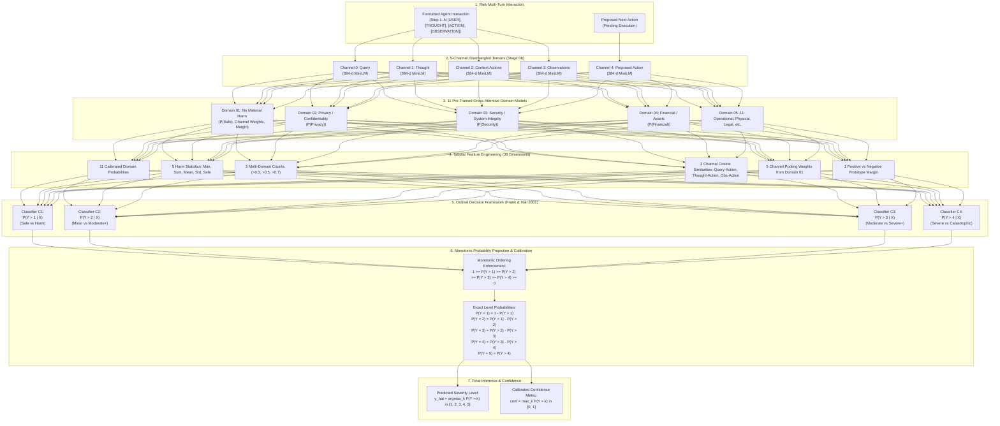

# Stage 09: Architectural Blueprint & Ordinal Decision Pipeline

## 1. High-Level Concept
Predicting agent interaction risk severity ($Y \in \{1, 2, 3, 4, 5\}$) is an inherently **ordinal classification problem** with a strong class imbalance:
- Level 1 (Safe): ~46.6%
- Level 2 (Minor/Nuisance): ~5.7%
- Level 3 (Moderate Harm): ~22.4%
- Level 4 (Severe/Systemic Harm): ~24.1%
- Level 5 (Catastrophic Harm): ~1.3%

Stage 09 resolves the exact accuracy bottleneck by replacing single continuous regression or unconstrained multi-class loss with:
1. **5-Channel Disentangled Cross-Attentive Feature Ingestion** from the 11 trained Stage 08 prototype networks.
2. **Frank & Hall (2001) Cumulative Link Ordinal Decomposition** converting the problem into 4 monotonic binary threshold classifiers.
3. **Calibrated Soft Consensus Gating** ensuring accurate decision boundaries between adjacent levels (especially Level 3 vs Level 4).

---

## 2. End-to-End System Flowchart

---

## 3. Mathematical Formulation of Frank & Hall Decomposition

Given an ordinal target $y_i \in \{1, 2, \dots, K\}$ with $K = 5$:
1. The target is partitioned into $K - 1 = 4$ binary indicators:
   $$z_{ik} = \mathbb{I}(y_i > k) \quad \text{for } k \in \{1, 2, 3, 4\}$$
2. Four binary classifiers $C_1, C_2, C_3, C_4$ are trained independently on the entire dataset:
   $$P_k(x) = P(Y > k \mid X = x) = C_k(x)$$
3. Because probabilities must be monotonically non-increasing as thresholds increase, we enforce:
   $$\tilde{P}_1(x) = P_1(x)$$
   $$\tilde{P}_k(x) = \min(\tilde{P}_{k-1}(x), P_k(x)) \quad \text{for } k \in \{2, 3, 4\}$$
4. The exact probability distribution over the discrete ordinal levels $\{1, 2, 3, 4, 5\}$ is given by:
   $$P(Y = 1 \mid x) = 1 - \tilde{P}_1(x)$$
   $$P(Y = k \mid x) = \tilde{P}_{k-1}(x) - \tilde{P}_k(x) \quad \text{for } k \in \{2, 3, 4\}$$
   $$P(Y = 5 \mid x) = \tilde{P}_4(x)$$
5. The final prediction $\hat{y}$ and confidence score $\mathcal{C}$ are:
   $$\hat{y} = \arg\max_{k \in \{1, \dots, 5\}} P(Y = k \mid x)$$
   $$\mathcal{C} = \max_{k \in \{1, \dots, 5\}} P(Y = k \mid x)$$

---

## 4. Key Strengths Over Stage 06 Continuous Regression
- **Eliminates Regression Median Hedging**: Continuous regression with MSE loss naturally hedges predictions towards the sample mean, causing severe confusion between adjacent levels (e.g. predicting 3.4 when true is 4).
- **Domain Specialization**: Classifier $C_1$ specializes strictly in Safe vs Harm; Classifier $C_3$ specializes strictly in Moderate vs High-Consequence harm.
- **Calibrated Uncertainty**: Samples where $P(Y=3) \approx P(Y=4)$ receive low confidence scores, enabling automated escalation to human supervisors.

